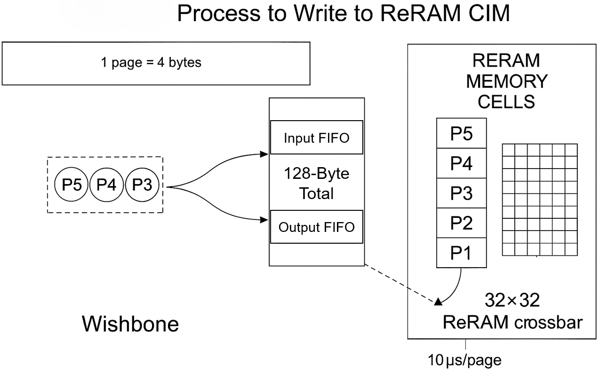

# sky130_bmlabs_reram

Open-PDK-style distribution of BM Labs ReRAM intellectual property for the
SkyWater SKY130 process.

The repository is intentionally independent of any particular chip project.
Projects consume a pinned revision of this repository as a Git submodule, so
IP releases and project integration changes can be reviewed and versioned
separately.

## Available IP

| Cell | Description | Process | Status |
| --- | --- | --- | --- |
| `sky130_bmlabs_reram__nvm32x32` | 32 x 32 1T1R analog in-memory-compute macro with a Wishbone interface | SKY130 | Hard macro |

Additional cells, such as independently distributable compute blocks, can be
added under the same `sky130_bmlabs_reram__*` namespace when their standalone
physical views are available.

## Repository layout

- `doc/`: interface and characterization documentation
- `gds/`: GDSII layout views
- `lef/`: abstract physical views
- `lib/`: timing models
- `verilog/`: black-box and behavioral simulation models

The canonical cell name is used consistently in every machine-readable view.

## Integration

Add the library to a project as a submodule:

```sh
git submodule add https://github.com/Baavanes/sky130_bmlabs_reram.git ip/sky130_bmlabs_reram
git submodule update --init --recursive
```

The Caravel integration example is maintained separately at
[`Baavanes/caravel_user_Neuromorphic_X2_32x32`](https://github.com/Baavanes/caravel_user_Neuromorphic_X2_32x32).

## Product summary

The current macro contains a 32 x 32 1T1R ReRAM crossbar for low-power matrix
operations. It targets always-on and edge-AI workloads where data-movement
energy and latency are important. See the files in `doc/` for the pinout,
timing, programming flow, and measured data.



The product page is available at
[bmsemi.io](https://bmsemi.io/commercial-neuromorphic-x1.html).

## License

Licensed under the Apache License 2.0. See [LICENSE](LICENSE).
